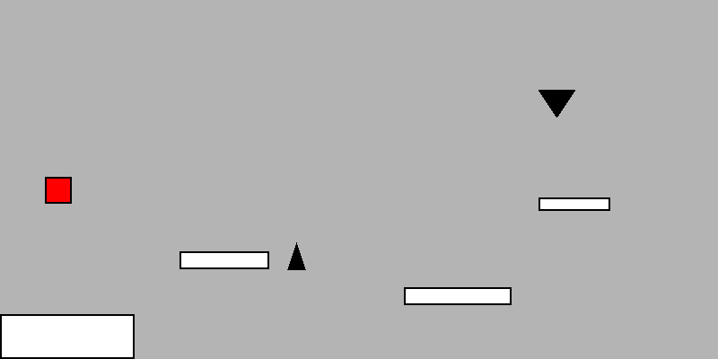

# 2D Platformer (Python / Pygame)

A small 2D platformer written in Python with Pygame. The player jumps between floating platforms, avoids spike hazards and respawns at the start when hit or after falling off the screen.

**Tools:** Python 3 · Pygame



## How it works

- **Physics.** Gravity is applied to the player every frame (`GRAVITY = 0.8`). A jump sets an upward velocity (`JUMP_STRENGTH = -15`), and jumping is only allowed while standing on a platform.
- **Platform collision.** Platforms are `pygame.Rect` objects stored in a list, so adding a platform takes one line. When the falling player overlaps a platform, they snap to its top edge and are marked as on the ground.
- **Hazards.** Spikes are triangles drawn with `pygame.draw.polygon`. Touching one resets the player.
- **Respawn.** Falling below the bottom of the screen also resets the player to the start.
- **Game loop.** Fixed 60 FPS: handle events, apply physics, check collisions, draw.

## How to run

```bash
pip install pygame
python platformer.py
```

**Controls:** `Space` to jump. Close the window to quit.

## Context

This was a two-person final project for **CMSI 1010** at Loyola Marymount University (Spring 2026), built with Severn Urbaniak.

- **My part (this file):** the player character, jumping and gravity, platform and spike collision, and the reset-on-death logic.
- **Severn's part (not included here):** the title screen, level-select menus and screen scrolling.
